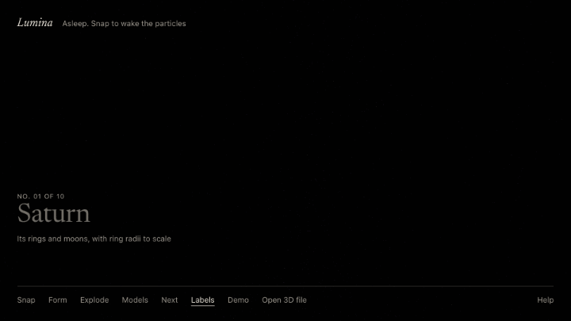
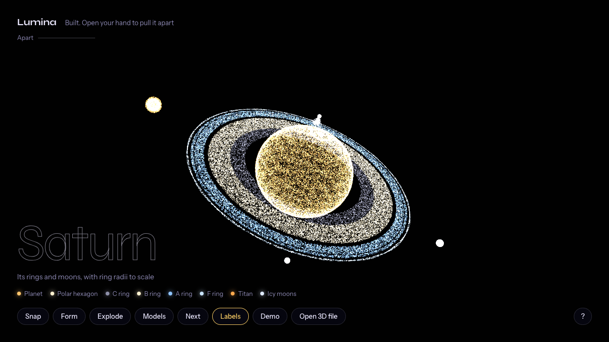
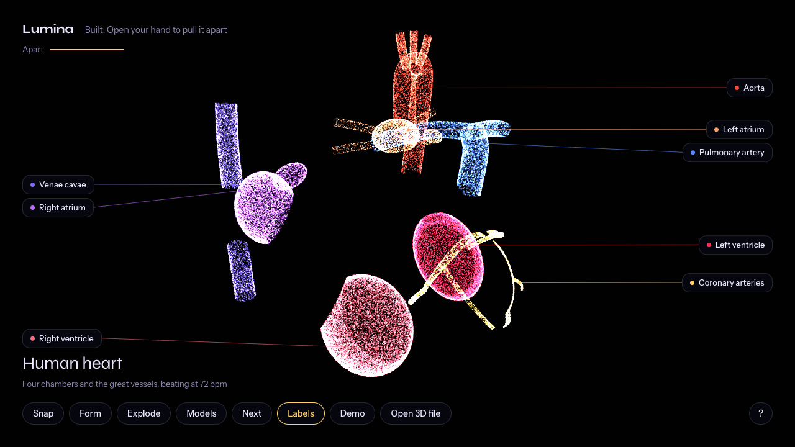
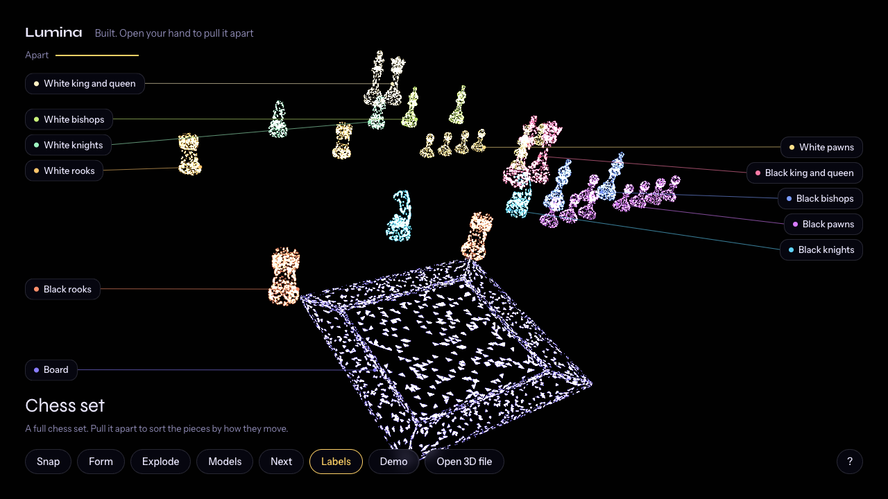

# Lumina

**Pull 3D models apart with your hands.** Lumina turns any model into 200,000 glowing particles in your browser. Snap your fingers to wake them, make a fist to build the model, and open your hand to pull it apart. Every part is labelled, and pointing at one tells you what it does. Drop in your own `.glb` file and it comes apart the same way.



**[Try it live →](https://osama-kn.github.io/lumina/)** Works with a webcam, or with just a keyboard, mouse or touch screen.

## What it does

- **Hand gestures, no controller.** Webcam hand tracking runs entirely in your browser. No video ever leaves your device.
- **Models that come apart.** Each part flies off in its own direction, and how far is set by how wide you open your hand.
- **Labels that explain.** Every part has a name and a one-line explanation. Point at a part, hover over it or tap it to read it.
- **Ten models to start with.** Seven are built from maths: Saturn, a beating human heart, DNA, the Eiffel Tower, a carbon atom, the Milky Way and a jet engine. Three are real 3D files: a chess set, a flight helmet and a drinks fridge.
- **Your own models.** Drag a `.glb` file onto the page. Every named object in it becomes a part you can pull apart.
- **Fast, and small enough to read.** A hand-written WebGL2 particle engine, with no Three.js and no build step. The whole app is plain JavaScript you can read in an afternoon.

| Built | Pulled apart | From a 3D file |
| --- | --- | --- |
|  |  |  |

## Run it on your computer

You need [Node.js](https://nodejs.org/) 18 or newer and, ideally, a webcam.

```bash
git clone https://github.com/Osama-kn/lumina.git
cd lumina
npm install
npm start
```

Open **http://localhost:5173** in Chrome or Edge and choose **Start with camera**. Browsers only allow the camera on `localhost` or `https`, which is why Lumina comes with a small local server. To use another port, run `npm start -- 8080`.

## How to use it

| Gesture | What it does |
| --- | --- |
| 🫰 Snap | Wake the particles, or send them back to sleep |
| ✊ Fist | Build the model. If it's apart, put it back together |
| ✋ Open hand | Pull the parts apart: the wider you open, the farther they go |
| 🤚 Tilt | Tilt your hand left or right to spin the model, up or down to tip it |
| ✌️ Peace | Next model |
| ☝️ Point | Point at a part to see what it does |
| 👋 Move | While the particles swirl, they follow your hand |

With the camera on, a small guide on the left lists these gestures. The ones that do something right now are bright, and the one your hand is making is underlined.

| Key or mouse | Action |
| --- | --- |
| `Space` | Snap |
| `F` / `O` / `V` | Fist / open hand / peace |
| `←` `→` | Previous / next model |
| `↑` `↓` | Pull apart / put together |
| `M` | List of all models |
| Drag, wheel | Rotate, zoom |
| Hover, click | See what a part does; click keeps it open, `Esc` closes it |
| `L` | Part labels on or off |
| `R` / `T` | Auto-rotate / motion trails |
| `C` | Camera on or off |
| `D` | Demo: a pretend hand plays through every gesture |
| `H` | Help |

On a phone or tablet, use the buttons at the bottom of the screen.

## Use your own 3D model

### In the browser

Drag a **`.glb`** file onto the page, or choose **Open 3D file**. Lumina reads it on your device, spreads particles evenly over its surfaces, and shows it built, ready to pull apart.

- **Parts come from the objects in your file.** A car modelled in Blender with objects called *Wheel*, *Door* and *Body* comes apart into those three pieces, labelled with those names. A file with a single object is split into regions.
- **Getting a `.glb`:** in Blender use *File → Export → glTF 2.0* and choose *glTF Binary*. Most models on [Sketchfab](https://sketchfab.com) can be downloaded as glTF too.
- **Limits:** up to 50 MB and 5 million triangles, and at most 12 parts (smaller pieces are merged into their neighbours). Compressed files (Draco or Meshopt) aren't supported yet; export without compression.

### In the code, for everyone who opens the app

1. Put `my-model.glb` in [`examples/`](examples/). If it's big, shrink it first: `node scripts/slim-glb.mjs big.glb examples/my-model.glb`.
2. Optionally add `examples/my-model.json` to give it a title, an explanation for each part, colours and directions.
3. Add one line to [`src/models/registry.js`](src/models/registry.js): `example('my-model', 'My model')`.
4. Run `npm test`. It checks that your model fits on screen, uses every part and builds fast enough.

You can also write a model as code, the way the planets and molecules are made. [`src/models/template.js`](src/models/template.js) is a short, commented example to copy. The full guide is in **[docs/adding-models.md](docs/adding-models.md)**.

## Where it can be used

Lumina started as a toy, but taking things apart in the air turns out to be a good way to explain them:

- **Classrooms and museums.** Students can pull apart a heart, an atom or an engine on a projector, and visitors can do the same at a kiosk without touching a shared screen.
- **Product explainers.** Show what's inside a device on a website or at a trade-show stand, straight from your existing CAD or Blender export.
- **Training.** Walk someone through how an assembly fits together before they handle the real thing.
- **Touch-free public displays.** Hand tracking means no buttons and no screen to wipe.
- **Talks and live demos.** Pull a model apart on stage while you explain it.
- **Creative coding.** The particle engine and gesture code are small and readable, and easy to reuse in your own projects.

## How it works

**Hand tracking.** [MediaPipe Hand Landmarker](https://ai.google.dev/edge/mediapipe/solutions/vision/hand_landmarker) finds 21 points on your hand in each webcam frame, on your device.

**Gestures** ([`src/logic/gestures.js`](src/logic/gestures.js)). Each finger's extension is measured as how much farther its tip is from the wrist than its middle joint, so it doesn't depend on hand size, distance or rotation. Poses are ranges of those four values. A snap is the thumb and middle finger held together for at least 40 ms, then flicked apart within 180 ms. A pose only counts once it has been steady for 110 ms, so a hand passing through a shape doesn't trigger it.

**State machine** ([`src/logic/controller.js`](src/logic/controller.js)). Three states (asleep, swirling, built) and a handful of transitions. It has no clock of its own, so the tests drive it directly.

**Particle engine** ([`src/gl/`](src/gl/)). Hand-written WebGL2. Each particle's position and velocity live in GPU buffers. Every frame, a vertex shader runs the physics for all particles and writes the results into a second buffer with *transform feedback*, then the two buffers swap. The CPU never touches individual particles after setup, which is what keeps hundreds of thousands of them smooth. Additive blending makes dense areas glow, and fading the previous frame instead of clearing it leaves short motion trails.

**Physics** ([`src/logic/physics.js`](src/logic/physics.js)). Asleep, particles drift to homes on a distant sphere. Swirling, they're pulled onto a shell around your palm. Built, each one is a damped spring to its point on the model, offset by its part's explode rule. The JavaScript version is a line-for-line copy of the shader, and a test checks that the GPU's output matches it.

**3D files** ([`src/models/gltf.js`](src/models/gltf.js), [`src/models/mesh-model.js`](src/models/mesh-model.js)). A small glTF reader of about 230 lines turns a `.glb` into named triangle meshes. Particles are then spread over the triangles in proportion to their area, so density is even. Objects become parts, the model is centred and scaled to fit, and each part gets a colour and a direction to fly in. All of this runs in a Web Worker, so even a big file never freezes the page.

**Models from maths** ([`src/models/procedural/`](src/models/procedural/)). The built-in models are sampled from equations rather than mesh files. Saturn's rings are at their real proportions with the Cassini Division, the heart beats in a lub-dub rhythm at 72 bpm, and the DNA has two or three hydrogen bonds per base pair.

**Labels** ([`src/logic/labels.js`](src/logic/labels.js)). Each part's label points at one of its own particles. Every frame that point goes through the same explode formula as the physics, and labels are stacked in columns so they never overlap.

## Options

| URL option | Effect |
| --- | --- |
| `?n=100000` | Number of particles (default 200,000) |
| `?model=2` | Start on a given model |
| `?autostart=camera` or `?autostart=nocamera` | Skip the start screen |
| `?trails=0` | Turn off motion trails |
| `?dpr=1` | Lower the render resolution on slower GPUs |

## Develop

```bash
npx playwright install chromium   # once
npm test                          # unit tests, then browser tests
npm run build                     # the static site, as deployed, in _site/
npm run capture                   # re-record the screenshots and GIF in docs/
```

- **Unit tests** (Node's built-in runner) cover gestures, the snap detector, the state machine, the physics, every model's rules, the glTF reader and mesh sampling.
- **Browser tests** (Playwright, with software WebGL so no GPU is needed) cover start-up, keyboard and pretend-hand control, the GPU physics against its JavaScript copy, every model, opening and dropping files, the model picker, hints, the phone layout and the built site served from a sub-path.

```
index.html, styles.css    the page
server.mjs                zero-dependency local server
src/main.js               frame loop, interface, input, camera preview, demo
src/hands.js              webcam and MediaPipe
src/gl/                   WebGL2 renderer and shaders
src/logic/                gestures, state machine, input, physics, labels, pretend hands
src/models/               model registry, glTF reader, mesh sampling, models built from maths
examples/                 bundled 3D files and their part descriptions
scripts/                  hand-model download, site build, screenshots, .glb slimming
tests/unit, tests/e2e     tests
```

## Roadmap

- Compressed glTF (Draco and Meshopt)
- Colours from textures, not just one colour per part
- More formats: `.obj` and `.stl`
- An npm package, so the engine can drop into other sites
- Two hands: rotate with one while pulling apart with the other

Ideas and pull requests are welcome; see [CONTRIBUTING.md](CONTRIBUTING.md).

## Troubleshooting

- **The camera doesn't start.** Open the app from `http://localhost:5173` rather than the file, and allow camera access when asked.
- **Hand tracking never loads.** Run `npm install` first: the tracking runtime is served from `node_modules`. If the hand model download failed during install, the app loads it from Google's servers instead, which needs an internet connection.
- **Low frame rate.** Try `http://localhost:5173/?n=80000&dpr=1`.
- **My file won't load.** The message says why. Most often the file is compressed or is a `.gltf` with separate files; export it from your 3D tool as an uncompressed `.glb`.

## Credits

Inspired by [WonderSnap](https://github.com/AkbarSheikh-debug/wondersnap) by Akbar Sheikh. Lumina is an independent implementation written from scratch.

The bundled 3D models come from the [Khronos glTF Sample Assets](https://github.com/KhronosGroup/glTF-Sample-Assets): see [examples/CREDITS.md](examples/CREDITS.md) for authors and licences. Hand tracking by [MediaPipe](https://ai.google.dev/edge/mediapipe) (Apache 2.0).

## License

[MIT](LICENSE) © Oussama
